# SombraSP · App do cidadão (Mobile Development & IoT)

Global Solution 2026.2 · FIAP · Engenharia de Software · Turma **3ESPH**

O SombraSP é o app do cidadão da CitizenTech. Nos dias de calor forte no Centro de São Paulo, ele mostra:

- o **alerta de calor do dia**;
- os **pontos de sombra e água mais próximos**, com o caminho a pé até cada um.

A pessoa pode **salvar os pontos** e **registrar as pausas para beber água**. Esses registros ficam no celular e funcionam sem internet.

O visual segue o padrão dos apps nativos do iPhone: barra de abas do sistema, títulos grandes, SF Symbols, listas agrupadas e vibração de confirmação.

<p align="center">
  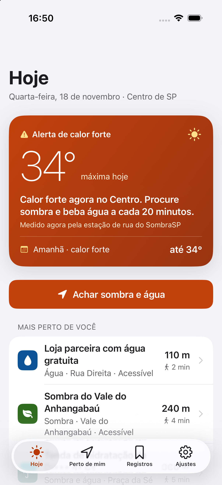
  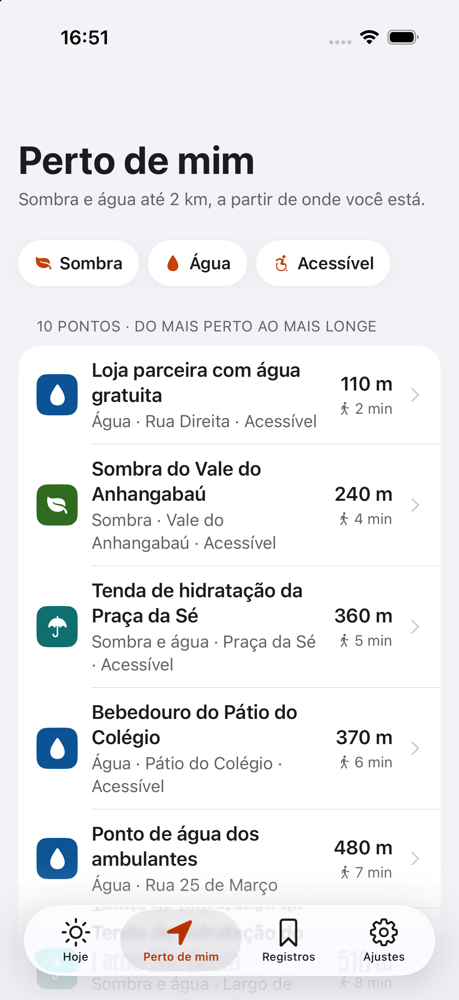
  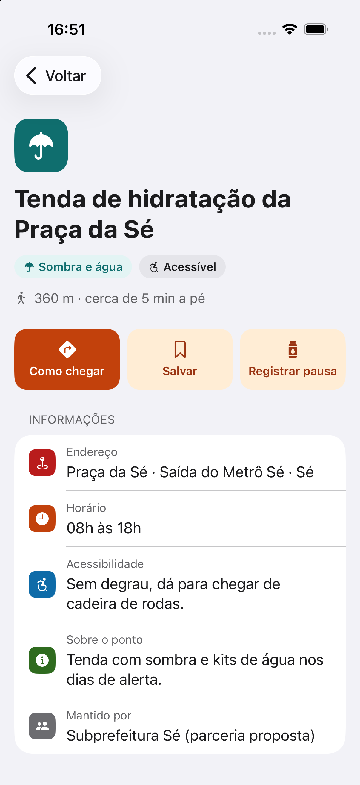
</p>

## Ficha da CitizenTech

| Campo | Valor |
|---|---|
| **Nome** | SombraSP |
| **Cidade e bairro** | São Paulo, Centro (Sé e República) |
| **Cidadão beneficiado** | Idosos e trabalhadores de rua (ambulantes, entregadores, garis) expostos ao sol |
| **Problema, em uma frase** | Nos dias de calor extremo, quem passa o dia na rua não recebe aviso a tempo nem sabe onde encontrar sombra e água por perto. |
| **Como funciona** | Sensores (ESP32) e dados meteorológicos públicos (INMET) estimam o risco de calor. Quando o risco sobe, a plataforma emite alertas e mostra pontos de sombra e hidratação próximos. |
| **O que cada parte faz** | **Mobile (este repositório):** app Expo em que o cidadão vê o alerta, acha sombra e água por perto, salva pontos e registra pausas. **SOA:** backend REST com os pontos de apoio e os alertas (o app já tem o adaptador para ele). **C#:** API de fotos dos pontos e distribuição de kits de água. **Cybersecurity:** detecção de dados sensíveis e painel de Risco Cidadão. **IA&ML:** prevê na véspera, com dados reais do INMET (estação A701), se a máxima passará de 31 °C. **Physical Computing:** estação ESP32 (Wokwi) mede temperatura e umidade e aciona alerta local. **Operating Systems:** infraestrutura Linux que hospeda a aplicação. **Testing:** features e casos de teste no Azure Boards. |
| **Indicador de impacto** | Nº de alertas emitidos em dias de risco e nº de consultas a pontos de sombra e hidratação |
| **ODS conectados** | ODS 3 (Saúde e bem-estar), ODS 10 (Redução das desigualdades), ODS 11 (Cidades sustentáveis), ODS 13 (Ação contra a mudança do clima) |

## Integrantes

| Nome completo | RM | Turma |
|---|---|---|
| Felipe Marques de Oliveira | 556319 | 3ESPH |
| Gabriel Barros Cisoto | 556309 | 3ESPH |

## Vídeo (até 3 minutos)

**Link (YouTube, não listado):** _a preencher_

O vídeo mostra a jornada completa:

1. ver o alerta;
2. achar um ponto e filtrar;
3. abrir a ficha do ponto;
4. salvar o ponto e registrar uma pausa;
5. fechar e reabrir o app para mostrar que os dados voltam do banco;
6. mostrar os estados de erro e vazio e o ajuste de letra.

## Jornada do cidadão

| # | Tela | O que a pessoa faz |
|---|---|---|
| 1 | **Hoje** (`app/(tabs)/(hoje)/index.tsx`) | Vê o alerta do dia num cartão no estilo do app Tempo. A cor muda com o nível: laranja para calor forte, vermelho para calor extremo, azul quando não há alerta. Vê também a temperatura, a previsão de amanhã, os 3 pontos mais perto, as pausas do dia e dicas simples. |
| 2 | **Perto de mim** (`app/(tabs)/(perto)/perto.tsx`) | Vê os pontos de sombra e água do mais perto ao mais longe, com a distância e os minutos a pé. Pode filtrar por Sombra, Água ou Acessível. A lista acompanha a pessoa andando. |
| 3 | **Ponto de apoio** (`app/ponto/[id].tsx`) | Vê a ficha do ponto, no estilo do app Mapas: endereço, horário, acessibilidade e quem mantém o ponto. Tem três ações: **Como chegar** (abre o Mapas a pé), **Salvar** e **Registrar pausa**. |
| 4 | **Meus registros** (`app/(tabs)/(registros)/registros.tsx`) | Vê os pontos salvos e o histórico de pausas, que vêm do SQLite. Pode remover um ponto ou apagar o histórico (com confirmação). |
| 5 | **Ajustes** (`app/(tabs)/(ajustes)/ajustes.tsx`) | Escolhe o tamanho da letra e a distância da busca (os dois ficam salvos no SQLite). Tem também o modo demonstração, "Sobre" e a equipe, no estilo dos Ajustes do iPhone. |
| 6 | **Guia visual** (`app/guia-visual.tsx`) | Mostra o design system do app funcionando: cores, contraste, tipografia e componentes. |

A navegação usa o **Expo Router**:

- **abas nativas do iOS** (`NativeTabs`), com o vidro do iOS 26 e SF Symbols;
- uma pilha por aba, com **título grande** que encolhe ao rolar;
- telas empilhadas para a ficha do ponto e o guia visual, com botão "Voltar".

## Como rodar

Pré-requisitos:

- Node.js 20 ou mais novo;
- o app **Expo Go** no celular, ou um simulador iOS ou emulador Android.

```bash
npm install
```

```bash
npx expo start
```

Depois, leia o QR Code com o Expo Go ou aperte `i` (iOS) ou `a` (Android) no terminal.

O app roda **sem nenhuma configuração**: os dados vêm do mock e o banco é criado no próprio aparelho na primeira abertura. Não há chave, senha nem conta a criar.

Testes e checagem de tipos:

```bash
npm test
```

```bash
npm run typecheck
```

Os testes são 76 e cobrem:

- as regras do domínio e a formatação;
- o mock: ordenação, filtros, lista vazia e falha;
- o **contraste de todas as cores do tema**, incluindo as duas pontas de cada gradiente.

### Localização

O app pede a localização só para calcular a distância até os pontos. A lista se atualiza sozinha quando a pessoa anda 50 m.

Se a pessoa negar o acesso, ou se estiver fora do Centro de SP (a mais de 15 km), as distâncias passam a ser contadas a partir da **Praça da Sé**, e o app avisa isso na tela. A localização não é salva no banco nem enviada a ninguém.

No simulador iOS, dá para fixar um ponto no Centro com:

```bash
xcrun simctl location booted set -23.5478,-46.6362
```

## Banco de dados: SQLite local (expo-sqlite)

**Por que SQLite no aparelho:**

- quem trabalha na rua no Centro nem sempre tem sinal ou pacote de dados, então os pontos salvos, as pausas e os ajustes precisam funcionar **offline**;
- é gratuito e não exige conta, chave ou servidor, então o professor roda com `npx expo start` e pronto;
- os registros são do próprio cidadão e ficam só no celular dele, o que é melhor para a privacidade.

O acesso ao banco fica numa camada própria, em `src/database`. As telas não escrevem SQL.

| Arquivo | Responsabilidade |
|---|---|
| `banco.ts` | Nome do banco e migração versionada por `PRAGMA user_version` (cria as tabelas na primeira abertura) |
| `pontosSalvos.ts` | `listarPontosSalvos`, `salvarPonto`, `removerPontoSalvo`, `pontoEstaSalvo` |
| `pausas.ts` | `registrarPausa`, `listarPausas`, `contarPausasDoDia`, `apagarPausas` |
| `preferencias.ts` | `lerPreferencias`, `gravarPreferencia` (tamanho da letra e distância da busca) |

Tabelas:

| Tabela | Colunas | O que guarda |
|---|---|---|
| `ponto_salvo` | `ponto_id` (PK), `nome`, `tipo` (CHECK), `logradouro`, `bairro`, `salvo_em` | Pontos que a pessoa salvou |
| `pausa_hidratacao` | `id` (PK autoincremento), `ponto_id`, `ponto_nome`, `temperatura_c`, `registrada_em` (com índice) | Pausas para beber água, com a temperatura do dia |
| `preferencia` | `chave` (PK), `valor` | Tamanho da letra e distância da busca |

O banco é aberto pelo `SQLiteProvider` em `app/_layout.tsx`, e as tabelas são criadas por `migrarBanco`. Os prints 05 e 06 mostram que os dados continuam lá depois de fechar o app por completo e abrir de novo.

## De onde vêm os dados

**Padrão da entrega: mock** (`src/services/mock`), com dados **simulados**:

- **Pontos de apoio:** são 10 pontos no Centro (Sé e República). Os 4 primeiros são os mesmos da carga inicial da API de SOA. Os outros ficam em praças e largos públicos, com **coordenadas aproximadas**. As tendas, os bebedouros e os parceiros são **fictícios**: são uma proposta do projeto, não um serviço que existe hoje.
- **Alertas:** usam sempre a data do dia em que o app é aberto. Os valores e as mensagens seguem a regra da Ficha (alerta a partir de 31 °C e calor extremo a partir de 35 °C) e a carga da API de SOA (34,2 °C medidos pela estação ESP32 e 33,5 °C de previsão do modelo de IA&ML com dados do INMET).
- **Nenhum dado pessoal real.** O app não pede nome, CPF nem telefone.

O mock simula a rede: as respostas demoram cerca de 0,7 s, para o estado "carregando" aparecer. Em **Ajustes → Demonstração** dá para:

- trocar o cenário (dia sem alerta, calor forte ou calor extremo);
- ligar **Simular falha de conexão**, para ver o estado de erro com o botão "Tentar de novo".

### Pronto para a API de SOA

A camada de serviços já está preparada para receber os endpoints da API REST do SombraSP, feita na disciplina de SOA (Spring Boot, repositório `sombrasp-soa`):

| Arquivo | Papel |
|---|---|
| `src/services/fonteDeDados.ts` | Contrato único que as telas usam |
| `src/services/mockSombraSP.ts` | Implementação com o mock (padrão) |
| `src/services/apiSombraSP.ts` | Implementação que chama a API de SOA |
| `src/services/http.ts` | `fetch` com tempo limite, tratamento de 204/404/erro e mensagens simples |
| `src/services/config.ts` | Escolha da fonte e as rotas da API |

Rotas usadas (todas GET públicas, sem token):

| Rota da API de SOA | Onde aparece no app |
|---|---|
| `GET /alertas/hoje` (204 quando não há alerta) | Cartão do alerta na tela Hoje |
| `GET /alertas?ativos=true` | Previsão de amanhã no cartão do alerta |
| `GET /pontos/proximos?latitude&longitude&raioKm&tipo&acessivel` | Lista Perto de mim e "Mais perto de você" |
| `GET /pontos/{id}` | Ficha do ponto de apoio |

Os tipos de `src/domain/tipos.ts` seguem os DTOs da API: `DadosDetalhamentoAlerta`, `DadosPontoProximo` e `DadosDetalhamentoPonto`. A regra de nível do alerta, a regra de tipo do ponto e a fórmula de distância (Haversine) também são as mesmas da API.

Para trocar o mock pela API, crie um `.env` a partir do `.env.example`:

```
EXPO_PUBLIC_FONTE_DADOS=api
EXPO_PUBLIC_API_URL=http://localhost:8085
```

O `.env` está no `.gitignore`. Mesmo assim, o app não precisa de nenhuma chave ou senha.

A troca foi testada com a API de SOA rodando no MySQL. Os prints 18 e 19 mostram:

- os 4 pontos vindos do banco da API;
- o app indicando "Fonte dos dados: API de SOA".

## Acessibilidade e usabilidade

- **Contraste:** todo texto passa de 4,5:1 (WCAG 2.1 AA), e os ícones que identificam algo passam de 3:1. O teste `src/theme/__tests__/contraste.test.ts` mede cada combinação, incluindo as duas pontas dos gradientes, e falha se alguma cair abaixo do limite. O cinza secundário padrão do iOS (3,4:1) foi trocado por um mais escuro (6,0:1). A tabela com os valores está em [`docs/DESIGN_SYSTEM.md`](docs/DESIGN_SYSTEM.md).
- **Fonte legível:** o app usa a fonte do sistema (San Francisco no iPhone) com os estilos de texto do iOS. O corpo tem 17 pt.
- **Letra ajustável:** em Ajustes, a pessoa escolhe Normal, Grande ou Muito grande. A escolha fica salva e vale no app todo, e o "Tamanho do Texto" do iPhone continua valendo por cima.
- **Leitor de tela (VoiceOver):**
  - todo elemento tocável tem `accessibilityRole`, `accessibilityLabel` e, quando ajuda, `accessibilityHint`;
  - as linhas leem uma frase completa, como "Tenda de hidratação da Praça da Sé. Sombra e água. A 360 metros, cerca de 5 minutos a pé. Acessível para cadeira de rodas…";
  - os filtros são lidos como `checkbox` e as opções como `radio`, com o estado;
  - remover um ponto salvo também é uma ação do VoiceOver;
  - os erros têm `role=alert`;
  - as confirmações são anunciadas, como "Pausa registrada às 16:52".
- **Cor nunca é o único sinal:** o nível do alerta, o tipo do ponto, o filtro ligado, a aba ativa e a opção marcada também têm texto, ícone ou ✓.
- **Vibração de confirmação** (`expo-haptics`) ao salvar, registrar uma pausa e escolher filtros e opções. Ela reforça a ação para quem está andando e não olha a tela.
- **Alvos grandes:** o mínimo é 44 pt (recomendação do iOS). Linhas e botões têm 52 pt.
- **Linguagem simples:** frases curtas e diretas ("Tentar de novo", "Achar sombra e água"), números com vírgula e distâncias em metros.

## Design system: "Clima"

O app é neutro como os apps nativos do iPhone: fundo cinza agrupado e células brancas. A cor aparece só onde importa:

- o **laranja do calor** é a cor de destaque e a do alerta;
- o **vermelho** marca o calor extremo;
- o **verde e o azul** mostram onde há alívio (sombra e água).

O tema é **centralizado em camadas**. Nenhuma tela usa cor em hexadecimal.

```
src/theme/paleta.ts      1. cores cruas (cinzas do iOS, laranja, vermelho, céu, água, folha, brisa)
src/theme/cores.ts       2. tokens semânticos (fundo.tela, texto.secundario, tint, nivel.ALERTA, tipo.SOMBRA…)
src/theme/tipografia.ts     estilos de texto do iOS e tamanhos de letra
src/theme/espacamento.ts    espaços, raios (cantos contínuos) e áreas de toque
src/theme/elevacao.ts       sombras
src/components/          3. componentes que só usam tokens
```

- A documentação completa está em [`docs/DESIGN_SYSTEM.md`](docs/DESIGN_SYSTEM.md): princípios, paleta, tokens, contraste medido, tipografia, ícones, componentes, padrões de tela e checklist.
- O catálogo ao vivo fica no app, em **Ajustes → Guia visual**.
- O ícone e a splash (gradiente laranja, sol e gota azul) são gerados por `scripts/gerar-icones.py` com as cores da paleta.

## Stack

| Item | Versão |
|---|---|
| Expo SDK | 57 |
| React Native / React | 0.86 / 19.2 |
| TypeScript | 6.0 (strict) |
| Expo Router | 57 (abas nativas `NativeTabs` + pilhas com título grande) |
| Banco | expo-sqlite 57 |
| Localização | expo-location 57 |
| Ícones | SF Symbols (`expo-symbols` 57) no iOS e Ionicons no Android |
| Vibração | expo-haptics 57 |
| Gradiente do alerta | expo-linear-gradient 57 |
| Testes | Jest 29 + babel-preset-expo |

Todos os itens são gratuitos e nenhum serviço pago é usado.

## Estrutura

```
app/                         telas (Expo Router)
  _layout.tsx                SQLiteProvider, preferências e pilha principal
  (tabs)/_layout.tsx         abas nativas do iOS
  (tabs)/(hoje)/             Hoje (pilha com título grande)
  (tabs)/(perto)/            Perto de mim
  (tabs)/(registros)/        Meus registros
  (tabs)/(ajustes)/          Ajustes
  ponto/[id].tsx             ficha do ponto de apoio
  guia-visual.tsx            catálogo do design system
src/
  components/                Grupo, Linha, LinhaPonto, CartaoAlerta, Botao, Filtro, Aviso, Estados, Icone…
  context/                   PreferenciasContext (letra, distância, modo demonstração)
  database/                  camada do SQLite (migração e repositórios)
  domain/                    tipos (contrato da API), regras e formatação
  hooks/                     useRecurso (carregando/erro/vazio/pronto) e useLocalizacao (ao vivo)
  navegacao/                 opções do cabeçalho nativo
  services/                  contrato de dados, mock, adaptador da API de SOA, cliente HTTP
  theme/                     design system em camadas
  utils/                     vibração de confirmação
docs/
  DESIGN_SYSTEM.md           padrão visual
  prints/                    telas do app
scripts/gerar-icones.py      gera o ícone e a splash
```

## Prints

Os prints foram tirados no simulador do iPhone 17 Pro (iOS 26.5), com o Expo Go, em 18/11/2026.

| | | |
|---|---|---|
| <br>**01** Hoje: alerta de calor forte e previsão de amanhã | 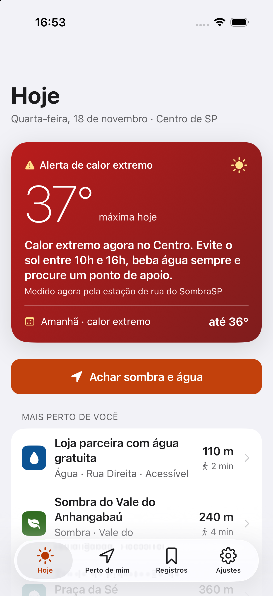<br>**11** Hoje: calor extremo | 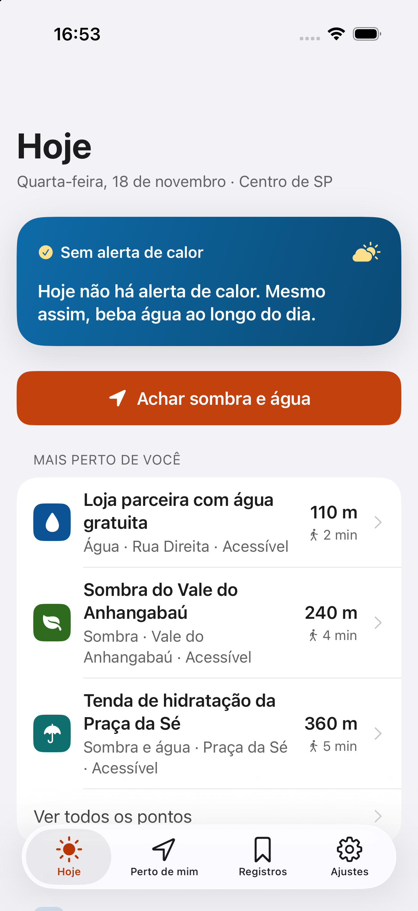<br>**12** Hoje: dia sem alerta |
| <br>**02** Perto de mim: lista por distância | 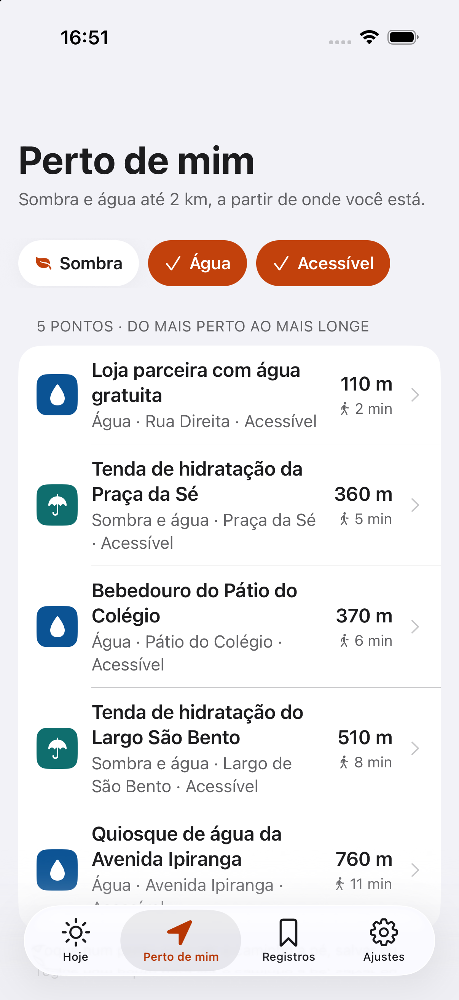<br>**03** Filtros Água e Acessível ligados | <br>**04** Ficha do ponto de apoio |
| 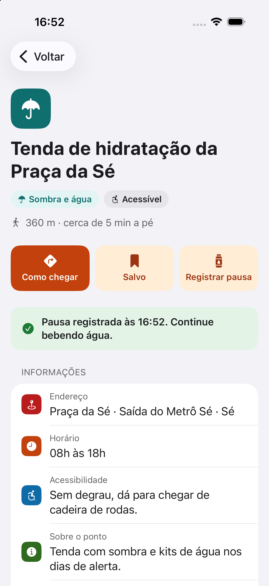<br>**05** Ponto salvo e pausa registrada no SQLite | 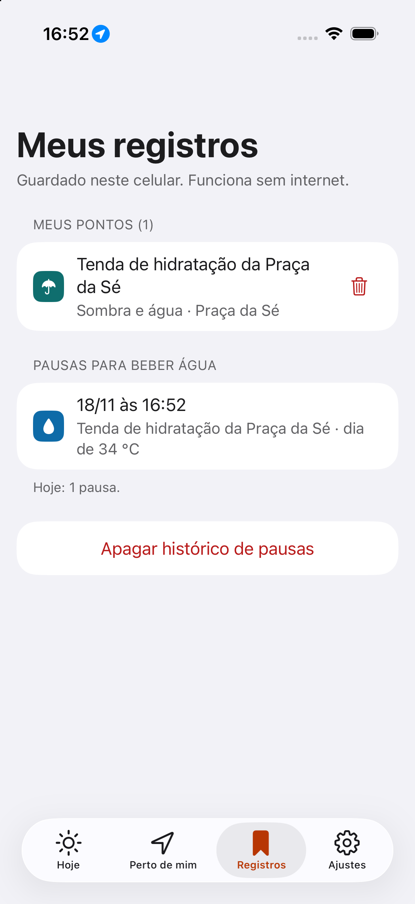<br>**06** Registros recuperados depois de fechar e abrir o app | 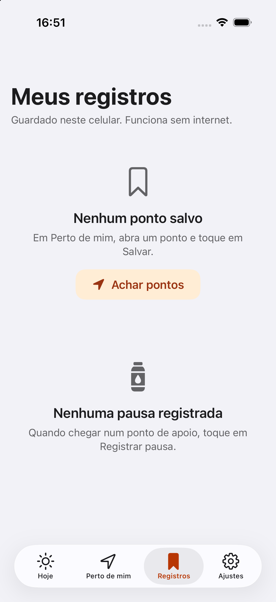<br>**08** Estado vazio de Registros |
| 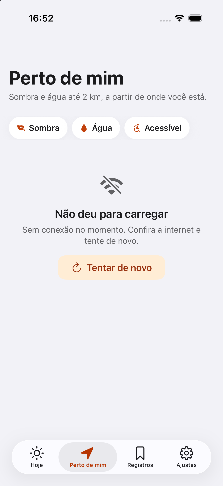<br>**07** Estado de erro com "Tentar de novo" | 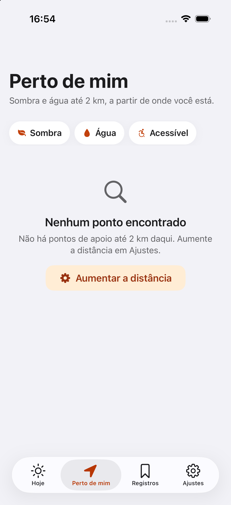<br>**14** Lista vazia (fora do raio) | 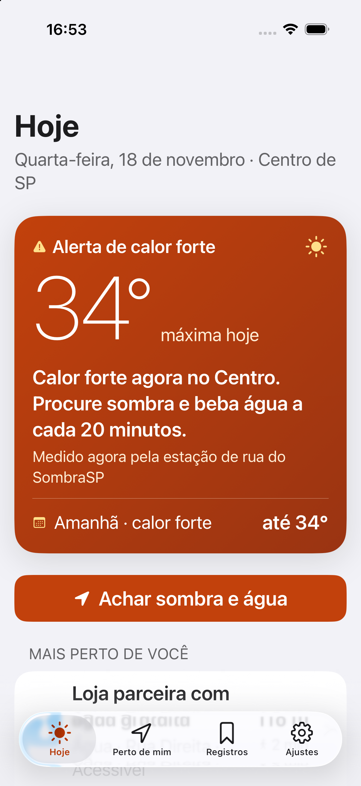<br>**13** Letra "Muito grande" |
| 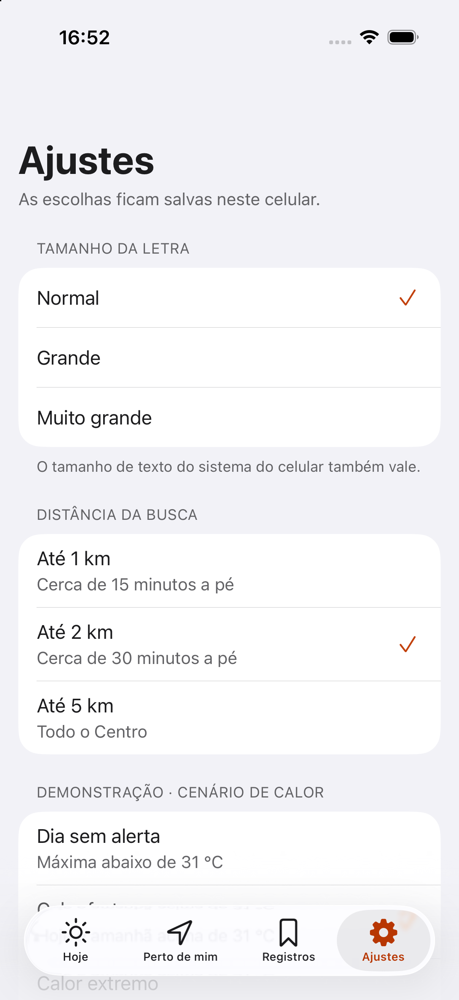<br>**09** Ajustes salvos no SQLite | 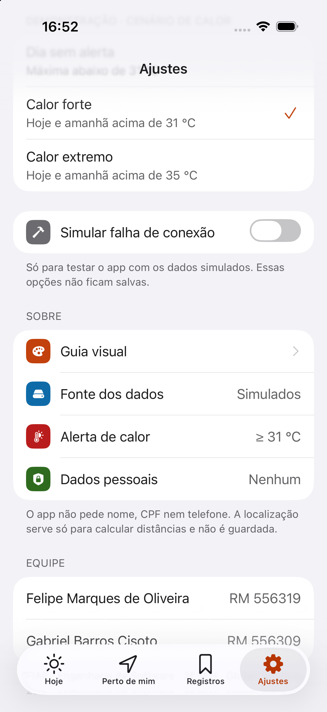<br>**10** Demonstração, Sobre e Equipe | 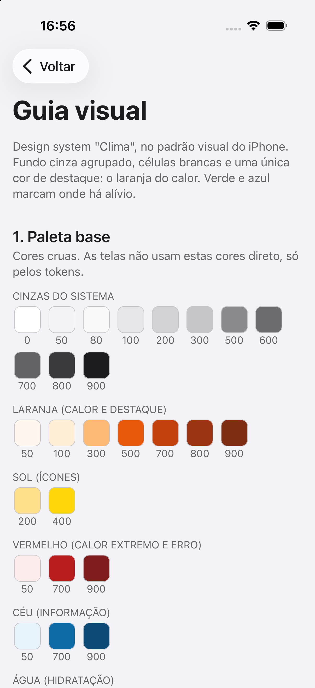<br>**15** Guia visual: paleta |
| 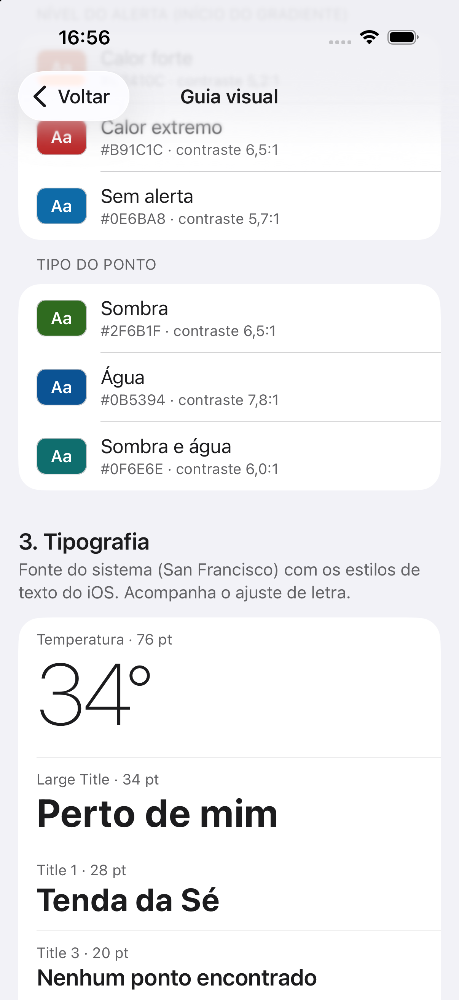<br>**16** Tokens com contraste e tipografia | 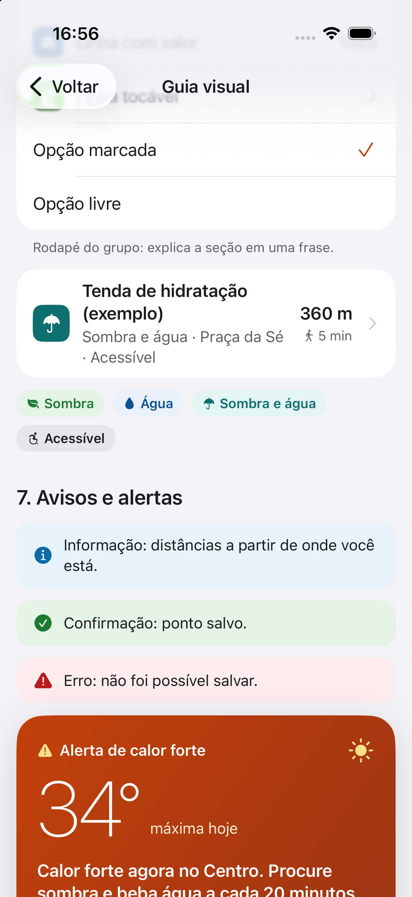<br>**17** Componentes | 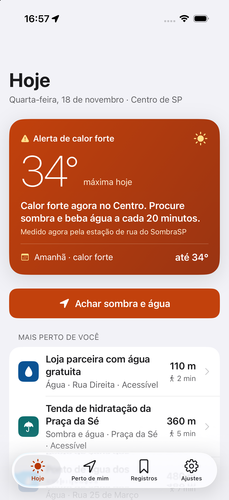<br>**18** Dados vindos da API de SOA (MySQL) |
| 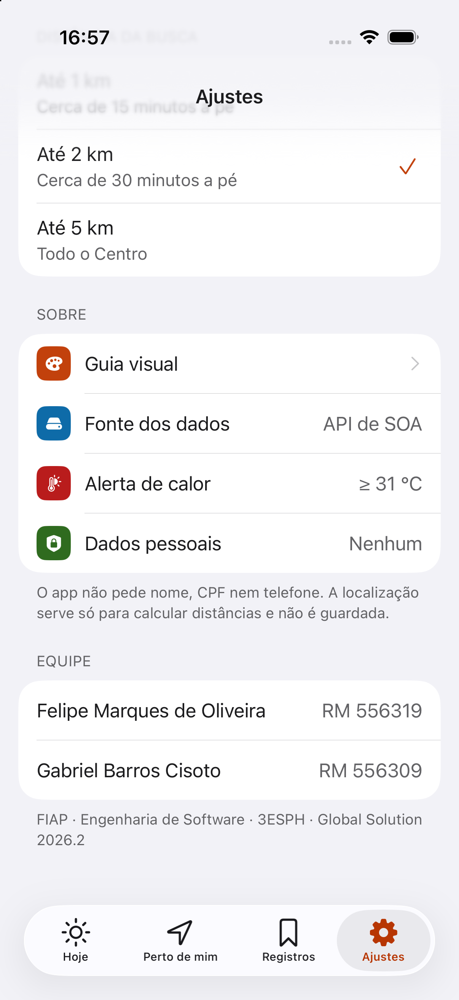<br>**19** Ajustes mostrando a fonte "API de SOA" | | |

## Uso de IA

Houve uso de IA no desenvolvimento. O registro está em [`prompts.md`](prompts.md).
